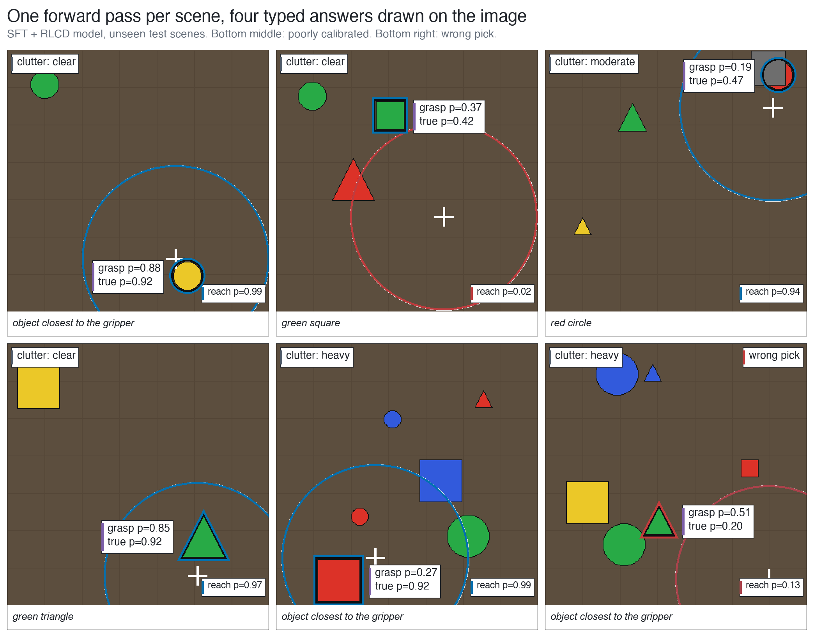
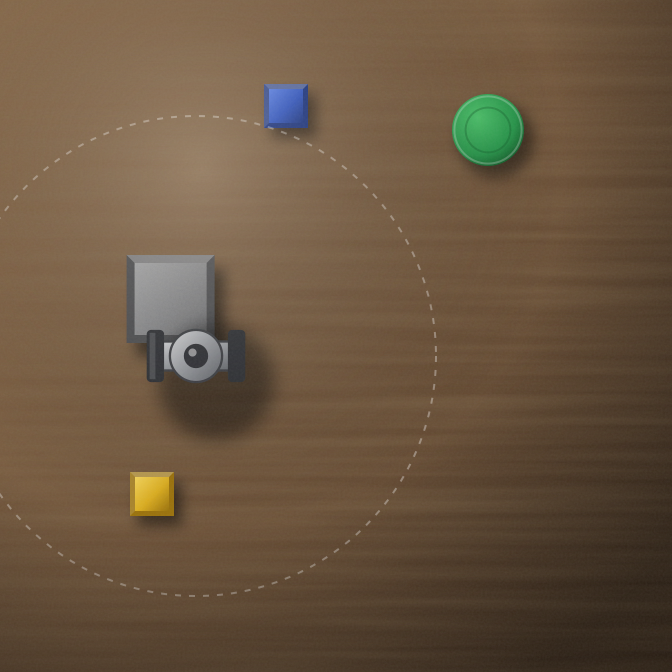
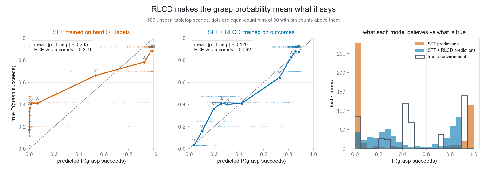
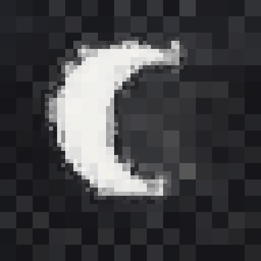
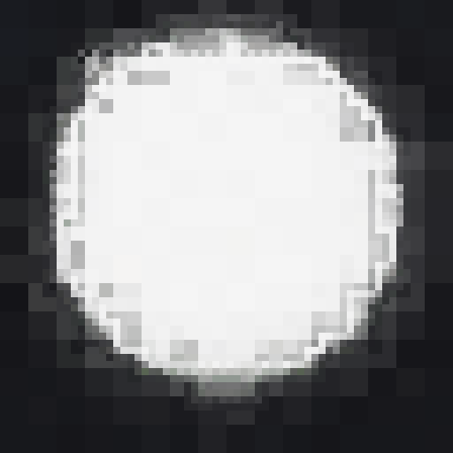
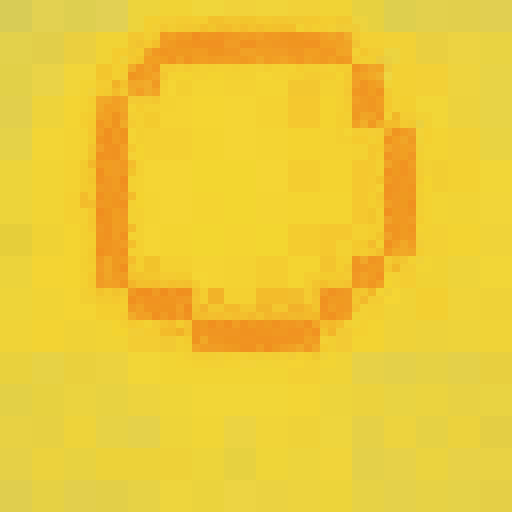
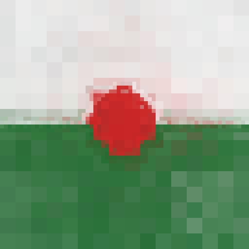
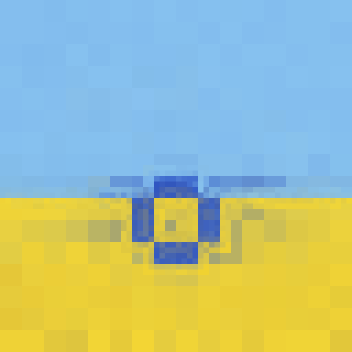
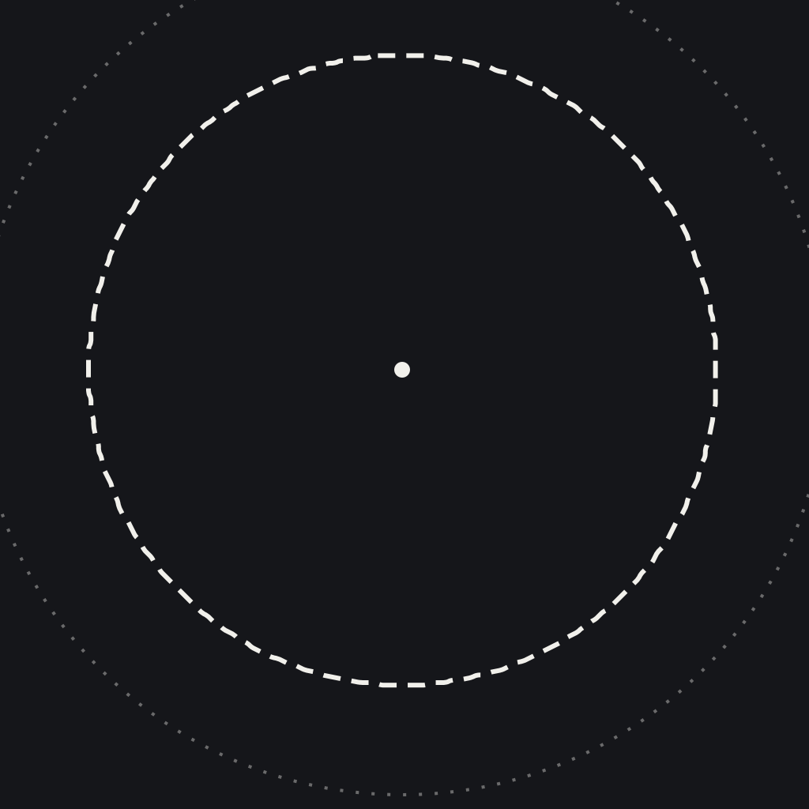

# sysone-vl

A model that looks at a cluttered scene, picks an object, and predicts whether a grasp will work.

<p align="center">
  
</p>
<p align="center"><i>Six test scenes the model did not see in training. Each label is a real output of the trained model.</i></p>

See it live at [sysone.warpfield.me](https://sysone.warpfield.me).

## What it does

You give the model one camera image of a table and one instruction. An example instruction is "pick up the object closest to the gripper." The model then answers four questions in one forward pass. It does not write text. Each answer is a probability.

| Question | Type of answer |
|---|---|
| Which object should the gripper pick? | one object from the objects on the table |
| Is that object inside the gripper's reach? | yes or no |
| Will a grasp on that object work right now? | a probability from 0 to 1 |
| How cluttered is the table? | clear, light, moderate or heavy |

The grasp answer is the important one. A robot can use it to decide what to do next: grasp now, move the other objects first, or ask a person. For this, the number must be honest. If the model says 0.25, the grasp must work about one time in four.

## One example scene

<p align="center">
  
</p>

This is one scene from the simulator. The instruction is "pick up the object closest to the gripper." These are the true answers:

| Question | True answer |
|---|---|
| Which object should the gripper pick? | green triangle |
| Is the target inside the gripper's reach? | yes |
| Will a grasp on it work right now? | one time in four |
| How cluttered is the table? | heavy |

The grey block is on top of the triangle. Because of the block, a grasp works only one time in four.

In the six scenes at the top, "grasp p" is the model's answer and "true p" is the simulator's answer. Two panels show mistakes. In the bottom middle panel, the model says 0.27 but the true value is 0.92. In the bottom right panel, the model picks the wrong object.

## How it works

The model starts from Qwen2.5-VL-3B, an open vision-language model. We removed its text output layer. We added one small answer head for each type of answer. A LoRA adapter (rank 16) trains the language model. The vision encoder does not change.

Training has two stages:

1. **Supervised training.** The model learns from labeled scenes. For the grasp question, each label is only "worked" or "failed." Because of this, the model learns to give probabilities near 0 or near 1.
2. **RLCD (reinforcement learning for calibrated decisions).** The model makes its decisions. The simulator then tries each grasp and returns the result. The model gets a score for how good its probability was.

## Results

All numbers come from `runs/*/eval.json` and `runs/baseline_generate.json`. Each test set has 500 new scenes. The baseline test set has 100.

| | Supervised only | After RLCD |
|---|---|---|
| Picks the right object | 98.8% | 99.2% |
| Gets reach right | 88.2% | 92.4% |
| Grasp calibration error | 0.21 | 0.06 |
| Grasp odds, average miss vs true odds | 0.24 | 0.13 |
| Time for one four-question query | 108 ms | 110 ms |

Calibration error shows how far the model's odds are from how often grasps really work. A lower value is better. We also tried temperature scaling on the supervised model. That is the usual quick fix. The grasp calibration error stayed at 0.21. RLCD decreased it to 0.06.

For comparison, we asked the untrained base model to reply with a letter. It picked the right object 69% of the time.

<p align="center">
  
</p>

## Train it yourself

You need an NVIDIA GPU. Our run used one L40S. Each training stage took about 11 minutes on it. The trained weights and the generated data are not in this repo. Make them yourself:

```bash
pip install -e .
bash scripts/run_pipeline.sh
```

The script does these steps in this order:

1. It builds the tabletop dataset.
2. It runs supervised training.
3. It fits temperatures.
4. It runs RLCD.
5. It evaluates each stage.
6. It runs the base model baseline.

To change the size of the run, set `TRAIN`, `EPOCHS` and `RLCD_STEPS`. For example:

```bash
TRAIN=1000 RLCD_STEPS=100 bash scripts/run_pipeline.sh
```

To serve the trained model and send it the scene above, run these two commands in two terminals:

```bash
python -m sysone.serve --ckpt runs/rlcd --port 8000
python scripts/demo_request.py http://localhost:8000/v1/decide
```

The simulator test runs on any computer:

```bash
python -m pytest tests/test_env.py
```

## Also in this repo: imagen

imagen makes pictures with a model that can only answer questions. It came after sysone-vl. It uses the same kind of typed questions, but it calls TypeSafe's hosted model, Jev.

<p align="center">
  
  
  
  
  
</p>
<p align="center"><i>"crescent moon", "full moon", "sun", "rose", "beach". 64 by 64 cells, unedited.</i></p>

### What it does

You type a prompt like "a sun in the sky over grass." imagen never asks a model to draw it. Instead it asks [Jev](https://typesafe.ai), TypeSafe's hosted decision model, a long list of typed questions. Jev writes no text. It only returns probabilities.

There are three kinds of question:

- **Choice:** pick one option from a list. Jev gives a probability for each option.
- **Score:** rate something on a scale. Jev gives a probability for each level.
- **Noul:** a yes or no question. Jev gives one probability.

Code does the geometry. Jev makes every decision about what goes in the picture.

### How it draws

1. **Layout.** Jev picks the main subject from the words in your prompt. It also picks a shape, a size, a spot on the canvas and the colors. It decides if there is a horizon and how high it sits. Code turns those answers into a plan.
2. **Pixels, coarse to fine.** Code builds the picture at a quarter size, then half size, then full size. Each cell is one Choice over a 16 color palette. The question tells Jev where the cell sits, which part of the plan it falls in and what its neighbors look like. Cells deep inside a solid area copy their parent, so Jev only gets asked about the cells that matter.
3. **Render.** Each cell is a blend of the palette, weighted by Jev's probabilities. That blend gives the pictures their soft edges and shading. Pass `--render hard` if you want flat colors instead.

<p align="center">
  
  
</p>
<p align="center"><i>Left: the layout Jev chose for "full moon". Right: the finished picture.</i></p>

### Numbers

These are the five pictures above, one run each from the chat page. The raw run reports are in [`docs/imagen/reports/`](docs/imagen/reports).

| Prompt | Time | Jev calls | Cells asked | Input tokens |
|---|---|---|---|---|
| crescent moon | 4.9 s | 16 | 1,128 | 0.38M |
| full moon | 5.2 s | 21 | 1,668 | 0.57M |
| sun | 4.9 s | 20 | 1,578 | 0.53M |
| rose | 3.6 s | 12 | 894 | 0.30M |
| beach | 3.6 s | 15 | 972 | 0.34M |

### Run it

You need Python 3.10 or newer and a TypeSafe API key. From the repo folder:

```bash
pip install httpx pillow fastapi uvicorn
export TYPESAFE_API_KEY=your-key-here
python -m imagen "a sun in the sky over grass" --grid 64 --out out/sun
```

The finished picture lands in `out/sun/best.png`. You also get one PNG per round and a `report.json` with the plan and the token count.

Options:

- `--grid` sets the canvas size in cells, from 16 to 128. The default is 32.
- `--render hard` uses flat palette colors instead of the soft blend.
- `--rounds` sets how many rounds each level runs. The default is 2.
- `--seed` fixes the random choices so you can repeat a run.

There is also a chat page that shows each round as it comes in:

```bash
python -m imagen.app
```

Then open http://127.0.0.1:7860.

The imagen tests mock the API, so they need no key:

```bash
pip install pytest
python -m pytest tests/test_imagen.py
```

## Limits

- sysone-vl was trained and tested only on a simple simulated tabletop with flat shapes. It has never seen a real robot or a real camera.
- The sysone-vl weights and data are not included. You need a GPU to train them, and `tests/test_tokenizer.py` downloads the Qwen model files the first time it runs.
- imagen needs a paid TypeSafe API key. Jev is a hosted model and is not part of this repo.
- imagen makes small pixel art with a sensible layout. It does not make photographs. The numbers above come from one run of each of five prompts.

## Repo layout

- `sysone/` the grasp model: tabletop simulator, model, training and evaluation
- `imagen/` the image generator: Jev client, layout and pixel questions, command line and chat page
- `scripts/` the training pipeline, the demo request and the figure script
- `runs/` configs, training logs and eval results from our run
- `docs/` figures
- `site/` the project website

## Credits

sysone-vl is our own typed decision model on an open vision model. It follows TypeSafe's public description of Jev and its Choice, Score and Noul types. imagen calls TypeSafe's hosted Jev API.

## License

MIT. See [LICENSE](LICENSE).

---

A Warpfield project
